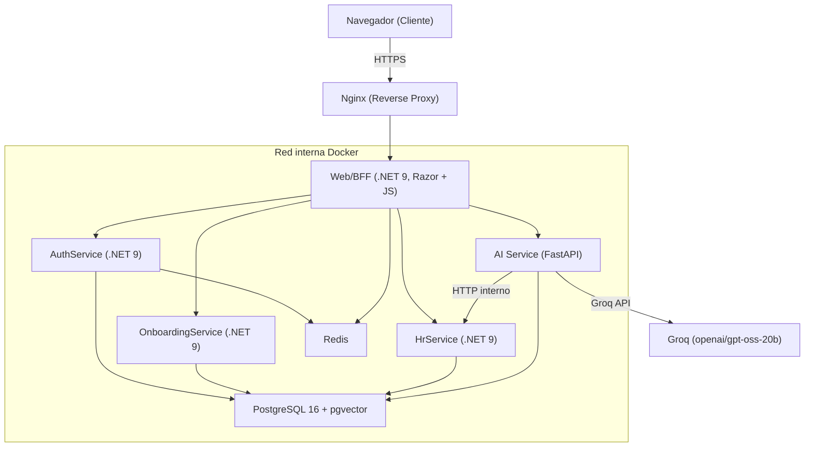
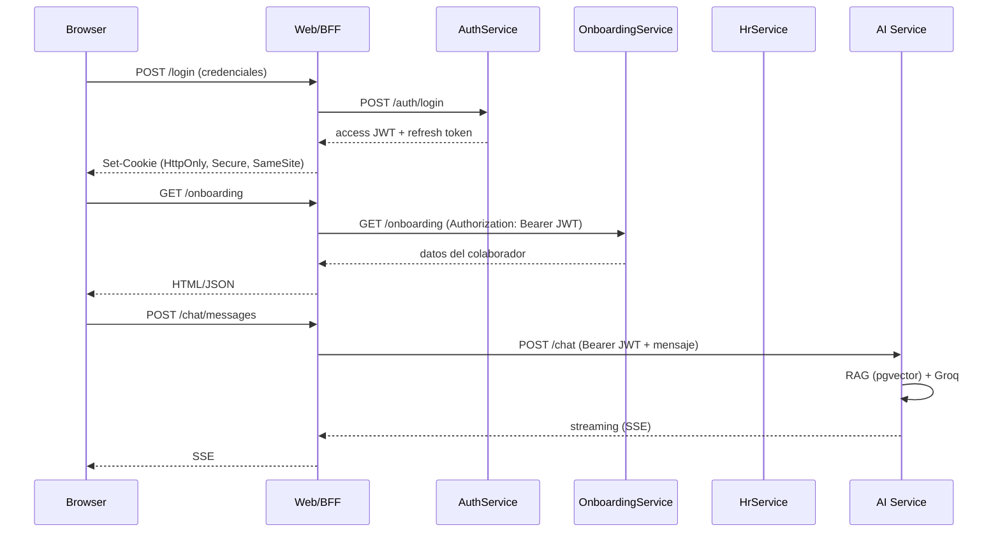
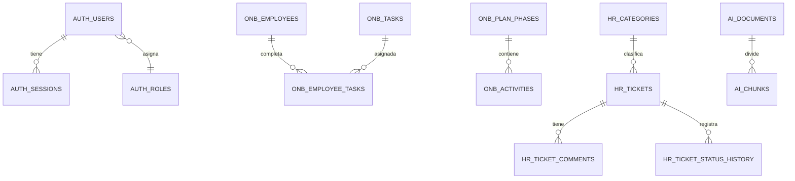
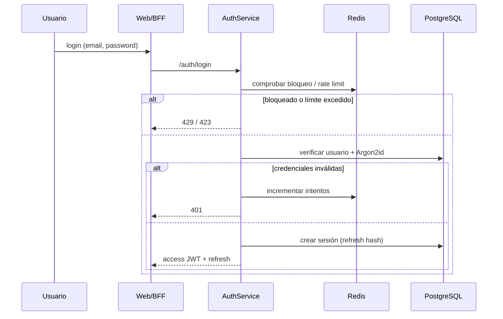
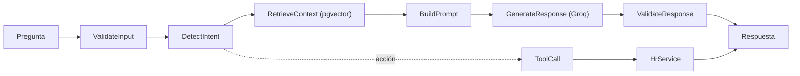
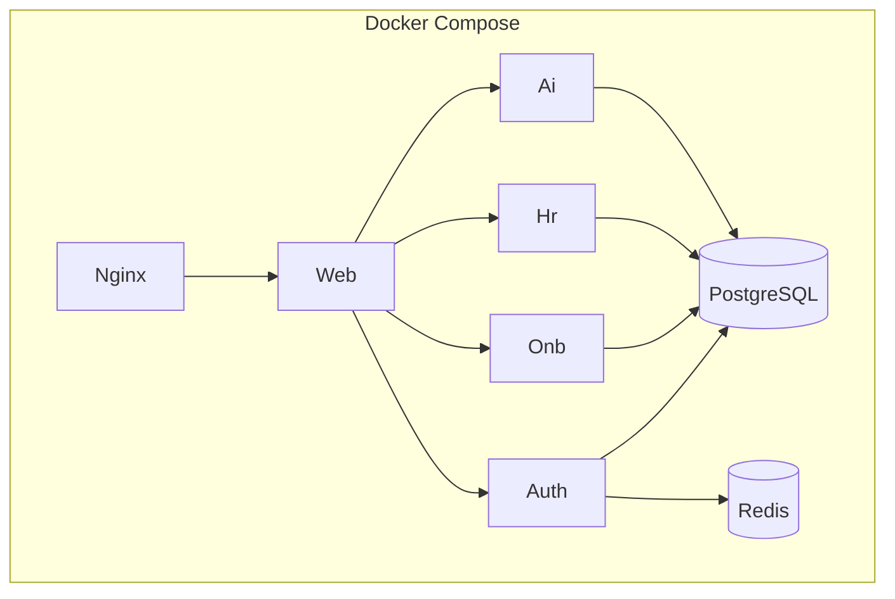
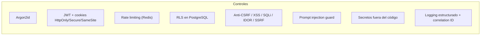

# Arquitectura del Sistema

Este documento describe la arquitectura real implementada. Complementa el PRD (`docs/PRD.md`).

## 1. Vista general

## 2. Microservicios

| Servicio | Tecnología | Responsabilidad |
|---|---|---|
| Web/BFF | .NET 9 ASP.NET Core (Razor Pages + JS) | Interfaz, sesiones, cookies, anti-CSRF, proxy a microservicios |
| AuthService | .NET 9 Web API + EF Core | Usuarios, login/logout, roles, bloqueo, auditoría, JWT |
| OnboardingService | .NET 9 Web API + EF Core | Perfil, tareas, checklist, progreso, plan 30-60-90 |
| HrService | .NET 9 Web API + EF Core | Tickets, solicitudes, estados, comentarios, historial |
| AI Service | Python + FastAPI + LangGraph | RAG, embeddings, pgvector, Groq, function calling |

## 3. Comunicación entre servicios

## 4. Base de datos

Schemas lógicos: `auth`, `onboarding`, `hr`, `ai`.

## 5. Autenticación

## 6. RAG

Pipeline de ingesta: Markdown → limpieza → chunking → embeddings → pgvector.

## 7. Deployment

## 8. Seguridad

