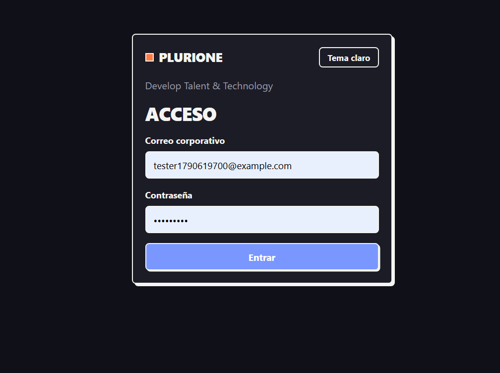
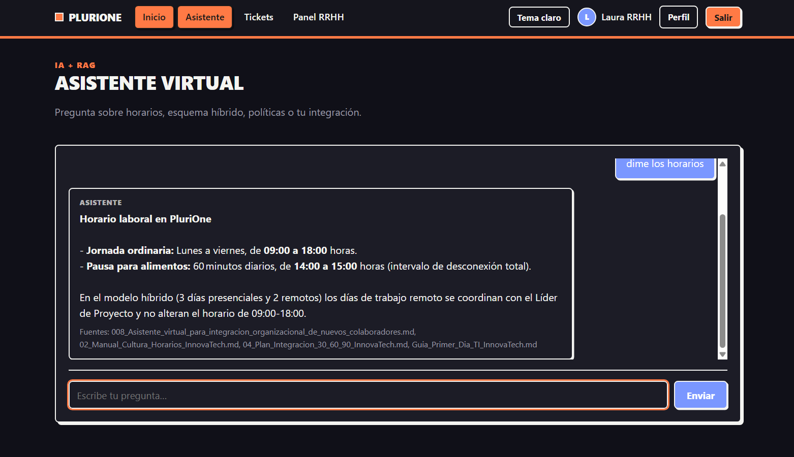
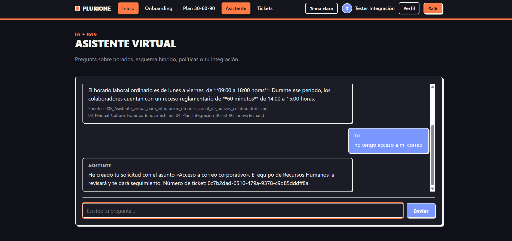
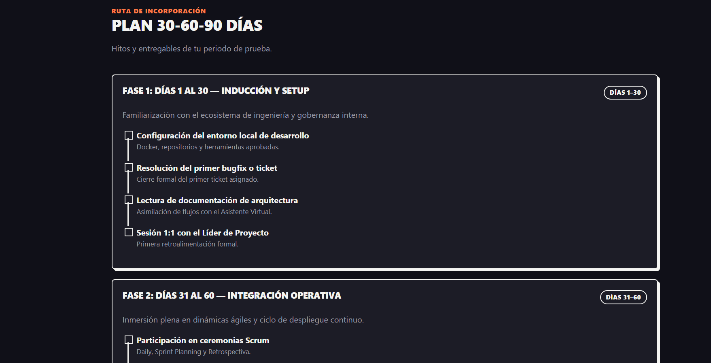
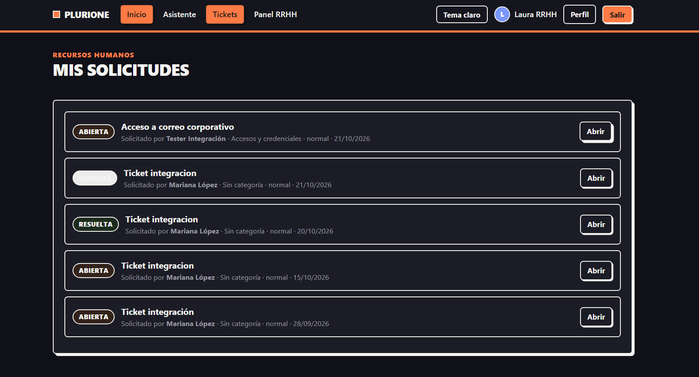

# Evidencias del MVP

Esta carpeta contiene evidencia de que el sistema funciona de punta a punta.

## Recorrido end-to-end (automatizado)

`integration_test_output.txt` — salida de `tests/e2e/integration_test.py`, ejecutado con el stack en Docker.

**Resultado: 15 comprobaciones correctas, 0 fallidas.**

El recorrido valida:

1. Autenticación y navegación por rol (colaborador, RRHH, admin).
2. Restricción del onboarding al rol colaborador (403 para RRHH/admin).
3. Tickets: creación, aislamiento por propietario (RLS) y visibilidad para RRHH.
4. Asistente (RAG): respuesta con streaming, fuentes citadas y término correcto.
5. Panel admin: lista de usuarios y acceso restringido (403 para RRHH).

## Cómo reproducirlo

```bash
docker compose up -d --build
docker exec -it plurione-ai-service python ingest_cli.py
python tests/e2e/integration_test.py
```

## Capturas del recorrido

1. **Login** — inicio de sesión.
   

2. **Chat con el asistente (RAG)** — respuesta con fuentes citadas.
   

3. **Ticket creado desde el chat** — *function calling* (`create_hr_ticket`).
   

4. **Checklist 30-60-90** — onboarding y plan de integración.
   

5. **Panel de Recursos Humanos** — lista de solicitudes.
   
